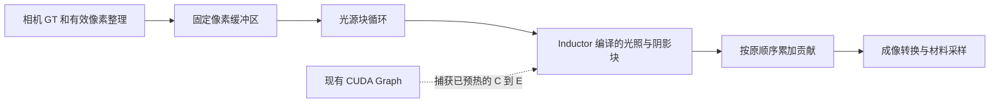

# PyTorch 渲染加速调研与下一阶段施工计划

> Historical design record: commands and config paths below predate the repository refactor. See [the current workflow](repository_workflow.md).

调研日期：2026-10-21。方案现已落地，以下保留设计与施工约定，并同步实际编译边界。最新结果见 [编译加速验收](pytorch_compile_acceleration_validation.md)，前一阶段实现见 [GPU 渲染优化](gpu_renderer_optimization.md)。

## 0. 已完成状态

原生 Windows 探针通过，已锁定可选依赖 `triton-windows==3.7.1.post27`。最终只编译几何、阴影与光照 factor，RGB 乘法及光源归约继续使用原 ATen 路径：扩大姿态集时，完整归约融合曾使一个量化临界通道变化，缩小编译边界后消除了差异。

25 个姿态加 reference、三轮对照中，当前路径传感器数组逐值一致；相对冻结的现有 CUDA Graph 基线，稳态中位数从 96.87 ms 降至 76.54 ms，约 1.27 倍。38 项回归通过。示例配置已启用 `compile_lighting="auto"`；auto 只在上下文第二帧初始化编译器，单帧保持原 GPU 路径。required 模式从首帧强制使用编译，以供验收。

## 1. 方案结论

选择 **用 `torch.compile(backend="inductor")` 编译固定大小的单个光源块计算，并继续复用现有手动 CUDA Graph**。

实施顺序：环境探针 → 当前路径 profiling → 提取纯张量光照块 → 单块编译与数值验证 → 接入现有 CUDA Graph → 对照测试及盈亏评估。暂不编译完整渲染入口，不改变几何精度、分辨率、光源采样密度或 LUT 算法。

选择原因：现有 CUDA Graph 已减少 CPU 提交开销，但重放图仍执行许多独立的逐元素及归约内核。Inductor 能融合适合的张量运算，减少中间数组的显存读写；这与现有执行图解决的问题互补。能融合多少、实际提速多少，必须测量，不能预先承诺。依据：[PyTorch 编译入门中的融合示例](https://docs.pytorch.org/docs/2.12/user_guide/torch_compiler/torch.compiler_get_started.html)。

最初环境缺少 Triton，最小 CUDA 编译探针曾报 `TritonMissing`；施工后已在隔离环境和项目环境打通后端。其他机器仍应先验证环境，不能把加一个装饰器当成完成施工；探针不通过时继续保留已有 GPU 路径。

## 2. 当前代码和基线

| 文件 | 当前职责 | 本阶段处理 |
| --- | --- | --- |
| `utils/renderer_gpu.py` | CUDA 上下文、相机 GT、分块光照、显示编码 | 提取光照块，增加编译执行器选择 |
| `utils/renderer_cuda_graph.py` | 固定像素缓冲区、球参数更新、执行图捕获及重放 | 捕获已经编译并预热的光照块调用 |
| `utils/geometry_gpu.py` | 平面/球冠求交及几何标签 | 抽出共享的纯张量求交内核，保留原包装 API |
| `utils/calibration_samples.py` | reference、材料网格、配对样本 | 保持算法；仅用于端到端正确性验证 |
| `utils/calibration_pipeline.py` | 扫描、保存、LUT 和 manifest | 增加编译性能与回退记录 |
| `utils/config.py`、`config.json` | 统一配置 | 增加一个编译模式字段 |
| `tests/benchmark_gpu_optimizations.py` | 原始循环与当前执行图对照 | 继续保留，不能拿原始慢循环作为新方案唯一基线 |

本次核验的本机环境：

- Windows 11；项目 `.venv` 的 Python 为 3.13.11。
- PyTorch `2.12.1+cu130`，CUDA runtime `13.0`。
- RTX 5050 Laptop，compute capability `12.0`，约 8 GB 显存。
- 调研时 `triton` 不存在；施工后已通过 `gpu-compile` 可选依赖安装 `triton-windows 3.7.1.post27`，float64、广播、姿态更新和手动图探针全部通过。
- `torch.profiler.supported_activities()` 返回 CPU 和 CUDA。仍需实际采集，不能仅以此证明 CUPTI 的所有事件均可用。

当前默认配置为：

```json
"render": {
  "geometry_dtype": "float64",
  "radiometry_dtype": "float32",
  "pixel_chunk_size": 16384,
  "light_chunk_size": 16,
  "cuda_graphs": true
}
```

现有文档记录：640×480、192 个灯采样点、开启阴影，当前路径稳态单帧中位数约 93.77 ms；更早的原始循环约 281.94 ms。这些是历史测量，不是本次编译收益。施工时重新生成同环境基线，即使历史报告已被清理也应能复测。

**新方案的主要比较对象必须是当前的 16384 分块 + CUDA Graph 路径。** 当前图的捕获、显存、PNG 写盘、LUT 拟合、分支分析都不能被误计为编译后的内核时间。

## 3. PyTorch 自身方案比较

下表中的适用性是结合本仓库代码的判断，性能收益尚未经过新实现实测。

| 方案 | 作用 | 本仓库判断 |
| --- | --- | --- |
| `torch.inference_mode()` | 关闭 autograd 跟踪等开销 | 已使用，继续保留 |
| `torch.cuda.CUDAGraph` | 重放固定执行序列，减少逐内核提交 | 已使用；作为新方案基线和外层执行机制 |
| `torch.compile` / Inductor | 编译张量计算，融合部分逐元素运算及归约 | **选用，先编译单个光源块** |
| `mode="reduce-overhead"` | 编译并尝试自动使用 CUDA Graph | 当前已有手动图，不作为首选，避免嵌套图管理 |
| `max-autotune` | 更积极调优，包含矩阵乘/卷积模板选择 | 当前主要是求交、逐元素运算和小维度归约；先不用，防止冷启动成本掩盖收益 |
| `torch.vmap` / 多姿态批处理 | 把批次维度推入运算 | 当前像素/光源已广播；增加姿态维度会扩大中间张量。保留为后续独立实验 |
| CUDA streams、异步拷贝、pinned memory | 在条件满足时重叠计算、数据搬运 | 将来若 profiling 显示预览和回传占主要时间再做，本阶段不混入 |
| AMP、FP16/BF16、TF32 | 对适合的算子采用较低精度计算 | 当前几何边界和阴影有严格精度要求，且不是大型矩阵乘任务，本阶段不采用 |
| `channels_last`、cuDNN benchmark、SDPA | 优化卷积或注意力等特定运算 | 当前热路径没有这些算子，无直接适用点 |
| `torch.export` / AOT 部署 | 提前导出或编译，管理部署时启动成本 | 可在 JIT 方案被验证后评估，不是第一步 |

参考：[torch.compile API](https://docs.pytorch.org/docs/2.12/generated/torch.compile.html)、[CUDA Graph](https://docs.pytorch.org/docs/2.12/notes/cuda.html#cuda-graphs)、[vmap](https://docs.pytorch.org/docs/2.12/generated/torch.vmap.html)、[PyTorch 性能调优](https://docs.pytorch.org/tutorials/recipes/recipes/tuning_guide.html)。

## 4. 阶段 A：先打通编译环境

### 4.1 环境路线

优先在独立环境验证原生 Windows，保留项目原有 `.venv`。Triton 主仓库当前列出的支持平台是 Linux；Windows 有维护者提供的 `triton-windows` 分支，不能将两者的支持范围混为一谈。[上游兼容性](https://github.com/triton-lang/triton#compatibility)、[Windows 分支说明](https://github.com/triton-lang/triton-windows/blob/readme/README.md)。

该 Windows 分支列出的配对是 **PyTorch 2.12 → Triton 3.7**，且列出了 sm120/RTX 50 系列支持。施工中从候选范围 `triton-windows>=3.7,<3.8` 选出并验证了 `3.7.1.post27`，项目已锁定此精确版本。不要直接安装任意最新版本，也不要同时安装 `triton` 和 `triton-windows` 到同一个 Windows 环境。[维护者兼容表](https://github.com/triton-lang/triton-windows/blob/readme/README.md#3-pytorch)。

施工中已用以下流程准备并验证隔离探针环境，随后通过项目的可选依赖同步到 `.venv`：

```powershell
uv venv --python .\.venv\Scripts\python.exe .venv-compile-probe
uv pip install --python .\.venv-compile-probe\Scripts\python.exe --index-url https://download.pytorch.org/whl/cu130 "torch==2.12.1"
uv pip install --python .\.venv-compile-probe\Scripts\python.exe "triton-windows>=3.7,<3.8"
```

必须确认安装解析没有替换成 CPU 版 torch，并记录 Python、torch、Triton、驱动、GPU 架构及实际编译工具链版本。CUDA runtime 与编译工具链不是同一个概念，不以 `torch.version.cuda` 单独证明工具链可用。

若原生 Windows 无法通过真实 CUDA 编译探针，使用已有 WSL2/Linux CUDA 环境作为备用验证路线。WSL2/Linux 必须使用自己的 Python 环境，不能复用 Windows `.venv`。不得因文档存在备用路线就自动安装/重配操作系统。不同操作系统的速度比较必须重新建立同系统基线。

### 4.2 需要实现的探针

新增 `tests/probe_torch_compile.py`，输出位置为 `results_lut/performance/compile_lighting/environment.json`，至少检查：

1. 版本、CUDA 可用性、设备型号、架构、Triton 是否可导入。
2. `torch._inductor.list_options()` 中是否有本计划使用的选项。
3. 编译并**实际调用** `sqrt(x*x + 0.5)`，输入为 CUDA float64 张量；同步后与 eager 对照。创建 compiled callable 成功不等于编译成功。
4. 编译包含广播、`where`、`isfinite` 和 `sum` 的小函数，输入包括位置、法线和动态更新的六元素参数张量。
5. 固定参数张量的 shape/dtype/stride，只用 `copy_` 更换内容，重复调用；用日志确认没有因数值变化重编译。
6. 将已经编译并执行过的函数放入手动 CUDA Graph，随后修改输入并重放，验证输出随输入更新。
7. 失败时保存异常类型、阶段及简短原因；探针进程以非零码退出，不把失败包装成性能成功。

编译缓存放 `.uv-cache/torch-compile/<环境标识>/`，通过 `TORCHINDUCTOR_CACHE_DIR`、`TRITON_CACHE_DIR` 在导入/首次使用编译器前设置。测冷启动时使用新的缓存子目录，不递归删除用户共享缓存。

通过后再将验证过的依赖加入 `pyproject.toml` 的可选 `gpu-compile` extra，更新 `uv.lock`；Windows 使用平台标记，Linux 优先遵循相应 torch wheel 的 Triton 依赖。记录最终锁定的精确版本；本阶段不凭猜测填写 wheel 的 post 版本号。后续同步命令为：

```powershell
uv sync --cache-dir .uv-cache --locked --extra gpu --extra calibration --extra gpu-compile
```

在环境及数值测试通过前，不改变默认 GPU 依赖，不降低原有 float64 精度来绕过编译失败。

## 5. 阶段 B：确认还剩哪些耗时

新增 `tests/benchmark_renderer_compile.py`，先实现 baseline/profile 模式，尚无编译实现时也可运行。

用 `torch.profiler` 采集短窗口，启用 CPU/CUDA activities、`record_shapes`、`profile_memory`；用 `record_function` 标记：相机 GT、有效像素整理、光照/阴影、成像转换、材料采样、回传与预览。profiler 只用于定位，正式速度数据另跑无 profiler 的计时。[官方 profiler 用法](https://docs.pytorch.org/tutorials/recipes/recipes/profiler_recipe.html)。

必须回答：

- 光照和阴影占单帧 GPU 时间的比例，以及主要内核数量。
- `positions[mask]` 等动态选择、参数更新和 `.item()`/同步造成多少主机等待。
- 图捕获/预热的首次成本与稳态成本分别是多少。
- 完整采样姿态中渲染、材料采样、回传和预览各耗时多少。

CUDA Graph 在某些 profiler 组合中可能不能完整展开内核。若出现这种情况，单独采集相同分块、不捕获图的光照块分析，并注明它是诊断对照，不把其耗时占比伪装为生产图内占比。若 CUDA 活动实际采集失败，记录缺失信息；仍可用 CUDA events 和同步后的墙钟计时。

只有 profiling 支持“光照块值得继续优化”后才执行后续阶段。如果主要耗时已转到 CPU 写盘或分支分析，记录结论，保留当前默认值，不为完成清单而强行启用编译。

## 6. 阶段 C：明确编译边界

### 6.1 不编译整个入口

`_render_tensors_once` 包含 config 深拷贝、动态有效像素选择、Python 循环和组装输出。`sample_pose` 还包含同步、计时及材料采样。对这些函数直接加 `torch.compile` 容易产生图断裂或按姿态重新编译。

本阶段保留相机 GT、动态索引、材料采样、显示编码、写盘及 LUT 在现有路径。新增 `utils/renderer_kernels.py`，只放无状态光照张量函数；新增 `utils/renderer_compiled.py` 管理可选编译、缓存和工作缓冲区。仅 GPU 渲染路径按需导入它们，避免离线歧义分析突然依赖 torch/Triton。



### 6.2 单块函数接口

eager 包装器为 `shade_light_block`，实际编译目标为 `light_block_factor`，输入约定：

| 参数 | shape / 类型 | 说明 |
| --- | --- | --- |
| `point`、`normal` | `[P,3]`，几何 dtype | 固定 P；连续、stride 固定 |
| `shadow_origin` | `[P,1,3]`，几何 dtype 或 None | 提前计算一次，避免逐灯块重复计算 |
| `light_points`、`light_normals` | `[L,3]`，几何 dtype | 当前光源块 |
| `light_powers` | `[L,3]`，辐射 dtype | 与现有功率分配完全相同 |
| `light_exponents`、`light_normalization` | `[L]`，几何 dtype | 使用已有常量 |
| `pose_parameters` | `[6]`，几何 dtype | 与当前执行图相同的六元素设备参数 |
| 静态参数 | Python 标量/布尔值 | 表面宽高、球半径、方向、阴影开关、是否指数全为 1 |

编译函数返回 `(factor, visible)`：分别为 `[P,L]` 辐射 dtype 和 bool。外层再执行原来的 RGB 乘法、当前光源块归约及逐块累加。eager 包装器返回 `(contribution, visible)`。保留 visibility 输出以便数值测试验证**同一个生产编译函数**的判定，不能另造数值不同的“测试版内核”。

从当前 `_shade_points` 的单次光源块体移植计算，严格保留：

1. 光源到表面点的向量、距离平方、`finfo(...).tiny` 下限和归一化。
2. 入射/出射余弦及截断顺序。
3. `1e-6 mm` 的阴影射线原点偏移和 `1e-5 mm` 的距离比较。
4. 原有平面/球冠有限范围、两根筛选、接触边界 `±1e-10` 和 `t_min=1e-7`。
5. 指数全为 1 的快路径，以及非整数指数的一般路径。
6. **编译区域结束于将 factor 转为辐射 dtype**，随后用原 ATen 运算乘 power 并沿当前光源块归约。
7. 外层仍按原光源块顺序累加。不能把 192 个灯一次性归约来换取速度，避免同时改变数值顺序和内存需求。

共享求交公式应从 `intersect_surface_torch` 提取为纯张量 helper；原包装函数继续服务相机和材料采样。不要长期维护两份独立求交公式。六元素参数仍为：`[cx, cy, center_z, contact2_low, contact2_high, has_sphere]`，由原 CPU 标量公式准备后传到设备，保持 float32 下原有舍入顺序。

编译函数内部不得读取整个 config、调用 NumPy、`.item()`、`.cpu()`、计时、打印、创建 CPU tensor 或按张量内容执行 Python `if`。`has_sphere` 用张量掩码；零压入和不同深度均走同一个 shape，不以 `float(depth)` 触发按姿态特化。

### 6.3 固定 shape 和尾块

- P 来自当前有效 `pixel_chunk_size`，在不超过图像像素数的范围内固定。
- 最后一个像素块补齐到 P，补零法线；输出只复制真实点数。对有图、无图的 compiled 路径都要这样处理，不能让无图路径按每个姿态的尾块长度重新编译。
- 光源尾块保留真实 L：通常只有完整 L 与一个尾部 L 两种 shape，最多准备两种内核。**不填充光源尾块**，以免改变归约顺序。默认 192/16 没有尾块，测试必须覆盖 12/5 等有尾块的情况。
- 球心和深度的变化只更新六元素 tensor 内容，不进入编译缓存键。
- 输出不能直接作为长期帧结果返回；先复制到独立 irradiance 数组，防止下次调用/图重放覆盖历史帧。

## 7. 阶段 D：编译配置与生命周期

### 7.1 首选编译参数

```python
options = {
    "triton.cudagraphs": False,
    "use_fast_math": False,
    "emulate_precision_casts": True,
    "eager_numerics.division_rounding": True,
    "eager_numerics.disable_ftz": True,
}
compiled_block = torch.compile(
    light_block_factor,
    backend="inductor",
    fullgraph=True,
    dynamic=False,
    options=options,
)
```

默认模式保持 `default`，代码中可省略 mode。`fullgraph=True` 用于让单块发生图断裂时明确报错；它表示一个可捕获图，**不表示最终只生成一个 GPU 内核**。`dynamic=False` 配合固定 shape，减少动态特化问题。[参数语义](https://docs.pytorch.org/docs/2.12/generated/torch.compile.html)。

关闭 Inductor 自身 CUDA Graph，由现有 `ShadingCudaGraph` 唯一管理图捕获。不使用 `reduce-overhead` 或默认会启用图的 `max-autotune` 叠加到手动捕获内部，也不在 GPU 扫描时自动尝试多个 mode。

本地 `torch/_inductor/config.py` 和 `codegen/triton.py` 已核验：存在上述选项；当前实现把 `emulate_precision_casts=True` 对应到生成代码的 `enable_fp_fusion=False`。这是为减少编译融合引起的舍入变化所作的版本相关选择，**不是通用的位级一致保证**。施工时检查实际安装版本的选项和生成代码，不虚构一个 `enable_fma` 配置键，也不能把 CPU 的 `cpp.enable_floating_point_contract_flag` 当作 GPU 控制。[版本源码](https://github.com/pytorch/pytorch/blob/v2.12.1/torch/_inductor/codegen/triton.py)。

`division_rounding` 要求更接近 eager 的除法舍入，`disable_ftz` 避免编译器采用不同的非正规数清零方式。若非整数幂仍有差异，可在确认 CUDA libdevice 实际可定位后，单独验证 `eager_numerics.use_pytorch_libdevice=True`；不能在工具链缺失时盲目打开并将加载失败归因于公式。[数值相关配置源码](https://github.com/pytorch/pytorch/blob/v2.12.1/torch/_inductor/config.py)。这些选项有性能成本，正确性门槛优先于只追求更低的毫秒数。

### 7.2 缓存和重编译

编译执行器的缓存键至少包括：设备与架构、P、实际 L、几何/辐射 dtype、输入 stride、表面尺寸、球半径、方向、阴影开关、指数快路径及编译选项。正常扫描只改变参数 tensor 内容，不增加变体。

所有实际会调用的 L 变体必须在进入 `torch.cuda.graph(...)` 前完成首次编译和预热。编译器首次执行会调用工具链、分配内存或测量内核，不能在图捕获中触发懒编译。顺序固定为：准备缓冲区 → 编译并真实调用各 shape → 独立流预热 → 捕获 → 正常重放。[捕获约束](https://docs.pytorch.org/docs/2.12/notes/cuda.html#constraints)。

使用 `TORCH_LOGS="graph_breaks,recompiles"` 做开发验收。更换 25 个球位置/深度后不应因姿态值产生新的编译；换 P/L 或物理静态参数允许出现新变体。`torch.compile` 的 guard 和重编译限制按 code object 管理；普通 Python 字典缓存不能绕过限制。不同配置的大矩阵测试可分独立进程运行，不通过无限提高重编译上限隐藏问题。

### 7.3 配置和失败语义

只在现有 `render` 新增一个字段，其他精度和分块仍使用原配置：

```json
"compile_lighting": "off"
```

| 值 | 行为 |
| --- | --- |
| `off` | 现有路径；省略字段时的默认值。环境中没有 Triton 也可运行 |
| `auto` | 从第二帧初始化后端并使用编译；失败后明确回到现有 GPU 路径并记录原因 |
| `required` | 编译不可用、失败或不支持该配置时明确报错；用于验收，防止测到 fallback 却误报编译提速 |

独立 `cuda_graphs` 开关继续有效，形成 eager、仅图、仅编译、编译+图四种受控对照。通过第 10 节门槛后，示例值已改为 `auto`；省略字段仍为 off，不支持编译的用户继续使用原 GPU 路径。

不设置全局 `torch._dynamo.config.suppress_errors=True`。`auto` 的编译失败只报告一次，后续不每姿态反复重试。`required` 不降级为 eager，不允许回落 CPU、降精度、关闭阴影或减灯采样。

OOM 必须优先交给原渲染重试流程：释放旧图、工作缓冲区及暂存输出，缩小分块，按新 P/L 准备内核并重新捕获。不能先被通用编译异常捕获，伪装成“不支持编译”。回退/重建后要确保旧执行图不再引用已释放或不同 shape 的输入。

`render_host` 单帧在 off/auto 时均不初始化编译器；required 在首帧强制初始化。编译成本计入真实启动耗时，不藏到“免费预热”里。离线 `--ambiguity-only` 不初始化编译器。

## 8. 文件级施工清单

| 文件 | 必须完成的工作 |
| --- | --- |
| `utils/renderer_kernels.py`（新增） | 原公式的纯张量单块函数；可选 GPU 导入；固定接口与 visibility 返回 |
| `utils/geometry_gpu.py` | 共用求交 helper；相机/材料采样原 API 保持可用 |
| `utils/renderer_compiled.py`（新增） | 后端探测、选项检查、shape 缓存、无图时的固定工作缓冲区、状态及失败原因 |
| `utils/renderer_gpu.py` | `_shade_points` 中选择块执行器；保留原累加顺序、OOM 策略及现有入口 |
| `utils/renderer_cuda_graph.py` | 复用参数打包；在捕获之前编译及预热所有变体；正确处理缓存失效 |
| `utils/config.py` | 仅接受 `off/auto/required` 字符串，默认 off；拒绝错误类型和拼写 |
| `config.json` | 增加有明确默认语义的编译模式字段，不另建第二份配置 |
| `utils/calibration_pipeline.py` | 保存真实生效路径、编译/捕获时间、版本、回退原因 |
| `pyproject.toml`、`uv.lock` | 环境探针通过后才加入可选后端依赖及锁定版本 |
| `tests/probe_torch_compile.py`（新增） | 环境/图捕获探针，JSON 结果与明确退出码 |
| `tests/test_renderer_compile.py`（新增） | 数值、动态姿态、尾块、失败与 OOM 回归 |
| `tests/benchmark_renderer_compile.py`（新增） | profiler、冷/热缓存、四模式与真实姿态对照 |
| `docs/gpu_renderer_optimization.md` | 更新最终结果，区分当前图收益和新增编译收益 |

根目录继续只保留现有主入口。测试与基准脚本放已忽略的 `tests/`，正式运行辅助代码放 `utils/`。

## 9. 正确性验收

### 9.1 测试矩阵

至少覆盖：

- 零压入 reference 在编译前、编译后和图重放后的结果。
- 默认配置所有深度各选姿态、左上相切位置、中心位置、右下边界；使用 `build_scan_poses` 生成，不手写另一套扫描算法。
- 两个 `direction_z`、阴影开/关、指数 1 和非整数指数。
- float64 几何 + float32/float64 辐射；float32 几何单独核验，不允许静默转 dtype。
- 像素块与光源块的整除和非整除情况，无有效像素的情况。
- 同一个工作区连续更换姿态，旧帧结果不被覆盖；半径、方向、分块改变时正确失效。
- 缺 Triton、编译错误、捕获错误、OOM、重编译限制，分别遵守模式语义。
- `required` 真正执行编译，`auto` 失败仍在 CUDA；离线歧义模式在没有 torch 时仍可运行。
- 八姿态小扫描完整保存样本、LUT 和图表，实际完整渲染调用仍为 reference 一次加每姿态一次；编译只预热块，不重渲染整个扫描。

### 9.2 数值门槛

PyTorch 不保证数学等价的不同执行方式产生位级相同的浮点结果，不能沿用上一阶段“逐值一致”作为未经验证的编译承诺。[数值准确性说明](https://docs.pytorch.org/docs/2.12/notes/numerical_accuracy.html)。本项目采用以下候选发布门槛：

1. 相机命中、阴影 visibility、接触范围和最终有效采样 mask 必须逐值相同；单独构造接近切线、球冠边缘与阴影偏移的用例。
2. 全 float64 对照先沿用现有 GPU/CPU 检查量级：GPU eager/compiled 与 CPU 的传感器、radiance 对照 `rtol=3e-10, atol=1e-13`；现有更严格的小测试不放宽。
3. 默认 float64 几何/float32 辐射，对 eager/compiled 记录最大绝对误差、相对误差分位数，暂定 `rtol=2e-6, atol=1e-12` 的物理量对照门槛；它是本计划提出的门槛，不是已经验证的结论。
4. 成像编码仍走原函数；固定验收集的 RGB8、样本索引、保存的配对颜色与坡度逐值对照，以确认量化阈值附近没有改变训练输入。这里比物理量 allclose 更严格，不能只检查渲染图肉眼相似。
5. LUT 留出验证的通过/失败状态与基线一致；不得仅靠放宽标定阈值“通过加速验收”。

如果融合导致可见性或量化结果变化，保存差异数量、最大误差和边界实例，保持编译模式非默认。先核对参数打包、归约顺序、生成代码的浮点融合设置；必要时缩小编译区域，保留几何判定在现有 eager CUDA 中。不能自动放宽阈值，也不能宣称 strict 选项保证逐位一致。

## 10. 性能验收与是否启用

### 10.1 受控对照

至少记录以下模式，精度、灯采样、分辨率、姿态集合完全一致：

| 模式 | 编译 | 手动图 | 用途 |
| --- | --- | --- | --- |
| baseline | off | true | 当前实际生产基线 |
| refactored baseline | off | true | 证明提取函数本身没有明显回归 |
| compile only | required | false | 区分融合本身与图重放收益 |
| compile + graph | required | true | 候选发布路径 |

微基准还测单个光照块，但发布结论以完整单帧和采样流程为准。不要只展示与旧 281.94 ms 路径的比值。

施工前保存当前渲染/求交实现的测试参考快照，记录文件 SHA256、Git HEAD 和工作区差异。当前工作区有尚未提交的实现，不能只记 HEAD 就声称冻结了当前基线；也不需要为此提交或覆盖用户修改。重构后的 off 路径与这份快照分别测量，避免四个模式实际都经过新实现却丢失原基线。

从默认扫描列表按固定索引均匀抽取 25 个姿态，覆盖各深度和边缘，另加零压入 reference；准备好形状后至少测两轮姿态。对相同姿态交替测 baseline 和 compiled，重复三个独立回合，降低 GPU 时钟/后台负载和先后顺序带来的偏差。

### 10.2 必须记录的指标

- 冷缓存首次真实编译时间、热缓存启动时间、图捕获时间、预热时间。
- 无 profiler 时的稳态 GPU event 时间和同步后墙钟时间，至少给 median/p95 和所有原始样本。
- PyTorch 峰值 allocated/reserved 显存，显卡总显存；比较内存时避免把其他模式存活的上下文算到当前模式。
- 渲染/材料采样/回传/预览分别耗时，短扫描含启动的总耗时。
- 实际后端、完整版本、P/L、dtype、编译选项、图断裂和重编译情况。

`torch.compile(...)` 创建包装器的时间不等于编译时间。首次调用及 GPU 同步必须包含在冷启动测量中。循环内不要夹入 `.cpu()`、图表绘制或 JSON 写盘后再声称是 GPU 内核时间。

发布门槛建议：正确性全部通过；相对当前 baseline 的稳态速度至少 **1.20 倍**，三个回合均有稳定收益；p95 不明显恶化；峰值显存不超过设备总显存的 70%，且满足本机其他必要开销。若只减少了内核数量却没有实际速度收益，保留 `off`。

同时计算启动成本的回本帧数：

```text
saved_per_frame = baseline_steady_seconds - compiled_steady_seconds
extra_startup = max(0, compiled_startup_seconds - baseline_startup_seconds)
break_even_frames = ceil(extra_startup / saved_per_frame)
```

若 `saved_per_frame <= 0`，不存在回本。比较当前 1316 姿态加 reference 的 1317 次完整渲染时，要计入额外编译成本；如果一次任务不能回本，就不应仅因稳态快而默认启用。报告中的短扫描总耗时和上述估计分开，不估算 LUT 拟合/分支分析也同步提速。

## 11. 输出约定与可观测性

新增测量统一写入 `results_lut/performance/compile_lighting/<run-id>/`：

```text
environment.json
profile.json
profile_summary.txt
benchmark.json
numerical_validation.json
```

只保存指标与可选 profiler trace；数值对照数组尽量在内存比较，不新增逐帧 sensor/GT NPZ 或整体曲面重建产物。小规模标定集成测试写到 `results_lut/benchmarks/compile_lighting/<run-id>/{baseline,compiled}/`，正式 LUT 标定仍按原目录规则执行，不覆盖现有正式数据。

当前完整标定要求输出目录为空。性能报告占用 `results_lut/` 后，集成验收必须用上述新建的子目录作为 `--out`，不能因为输出根目录非空就删除已有数据。

在 manifest 的 `performance` 追加以下字段，原图统计继续保留：

- `compile_lighting_requested`、`compile_lighting_effective`。
- `compile_backend`、`compile_options`、`compile_versions`。
- `compile_variant_count`：执行器准备的 shape/静态键数，不能冒充真实 Dynamo 重编译次数。
- `compile_first_call_seconds`、`compile_warmup_seconds`、`compile_graph_capture_seconds`。
- `compile_fallback_reason`、`compile_failure_stage`，成功时为 null。
- `compile_validation_status`；未执行专项数值验收不能写成 passed。

每次启用、失败或因 OOM 重建时打印简短状态；正常逐姿态不重复输出编译长日志。JSON 中必须区分“请求了 compiled”和“实际执行了 compiled”。

## 12. 分阶段交付与停止条件

1. **A：环境探针**——记录当前失败，并在隔离环境验证可用的编译工具链。失败则交付原因及现有 GPU 路径，不继续 B 以后的重构。
2. **B：profiling 与基线**——确认光照/阴影仍是值得优化的区域；冻结配置、版本及姿态集合。
3. **C：共享函数提取**——编译保持 off，先通过现有回归和 eager 对照；不能一边改公式一边测编译。
4. **D：单块 required 编译**——完成 shape、精度、参数更新及尾块测试，没有图断裂。
5. **E：接入手动图**——编译发生在捕获之前，图重放正确更新姿态，失败及 OOM 语义完整。
6. **F：端到端与收益判断**——执行八姿态小扫描、四模式对照、启动成本及回本计算；满足门槛再决定示例配置是否启用 auto。
7. **G：文档与报告**——更新已验证版本、真实收益和限制。只有编译生效且验证通过的数据才能称为本方案结果。

以下脚本和参数现已实现，可用于复测：

```powershell
.\.venv\Scripts\python.exe tests/probe_torch_compile.py --out results_lut/performance/compile_lighting/environment.json
.\.venv\Scripts\python.exe tests/benchmark_renderer_compile.py --config config.json --profile --out results_lut/performance/compile_lighting/profile_run
.\.venv\Scripts\python.exe -m unittest discover -s tests -p test_renderer_compile.py -v
.\.venv\Scripts\python.exe -m unittest discover -s tests -v
.\.venv\Scripts\python.exe tests/benchmark_renderer_compile.py --config config.json --poses 25 --rounds 3 --out results_lut/performance/compile_lighting/acceptance_run
```

不要在探针、数值或性能门槛尚未通过时直接启动 1316 姿态的正式重标定。编译优化也不要求重新渲染已有样本来运行歧义/分支分析。
